# DeckForge Commander

Turn a program's stdout into text, progress, or images on a Stream Deck key. An open-source Stream Deck plugin.

**Navigation:** [Available keys](#available-keys) · [Install a packaged build](#install-a-packaged-build) · [Build from source](#build-from-source) · [First key](#first-key) · [Examples](#examples) · [Demos](demos/README.md) · [Protocol](#protocol) · [Windows guide](docs/windows-support.md)

<p align="center" width="100%">
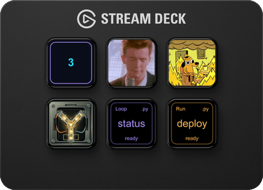
</p>

<p align="center">
<a href="demos/showcase.py">showcase.py</a> • <a href="demos/video.sh">video.sh</a> • <a href="demos/gif.py">gif.py</a> • <a href="demos/fluxcapacitor.py">fluxcapacitor.py</a>
</p>

**Requirements**

- **Runtime:** macOS 13+ or Windows 11 x64 · Stream Deck 7.1+
- **Build:** Node.js 24 and npm on macOS arm64/x64, Linux x64 (build-only), or Windows x64; internet access is needed for the first build (see the Windows guide)
- **Demos:** See [demo requirements](demos/README.md).

## Available keys

<table>
<thead><tr><th>Preview</th><th>Key</th><th>Usage</th><th>Behavior</th></tr></thead>
<tbody>
<tr><td>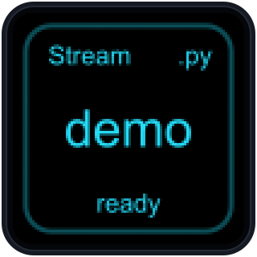</td><td><strong>Stream</strong></td><td>Tap to start or stop.</td><td>Runs until stopped or the program exits. Remembers start/stop intent across reconnects and can restart if still requested.</td></tr>
<tr><td>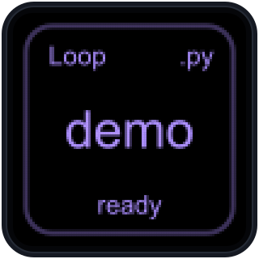</td><td><strong>Loop</strong></td><td>Tap to start/refresh; hold for one second to stop.</td><td>Repeats after each completion and the selected delay. Remains disabled after reconnect.</td></tr>
<tr><td>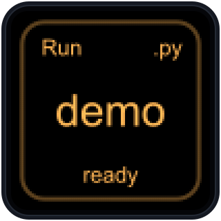</td><td><strong>Run</strong></td><td>Tap to execute once. Busy taps are ignored; hold one second to stop.</td><td>Runs once and retains successful output. Never restarts automatically.</td></tr>
</tbody>
</table>

**Run and Loop** keep a successful run's final output visible, if any. Loop retains it between runs; no-output success shows `success`.

Hidden keys do not start background work: Stream stops, while Loop and Run may let a current child finish locally but will not launch another. Device disconnect stops execution. The reconnect behavior above applies within the same plugin session; restarting the plugin starts all keys stopped.

Choose an absolute executable path. Programs run directly with your permissions—no shell or plugin `PATH` lookup. On macOS, executable scripts use their shebang; on Windows, select an interpreter executable and pass the script path as an argument. Use only programs you trust; see [Windows setup](docs/windows-support.md#choose-an-executable).

In Windows **Arguments**, backslashes stay literal: `C:\Scripts\showcase.py` is one argument. Use single or double quotes to group spaces, such as `'C:\My Scripts\showcase.py'` or `"C:\My Scripts\showcase.py"`.

## Install a packaged build

With Stream Deck installed, open `git.renaudcerrato.deckforge.streamDeckPlugin`, then [create your first key](#first-key).

## Build from source

```sh
npm install
npm run pack
```

Open the resulting `dist/git.renaudcerrato.deckforge.streamDeckPlugin` to install. Use `npm run build` to build without packaging. Building requires neither Stream Deck nor a device; see [Requirements](#requirements) and the [Windows guide](docs/windows-support.md).

For an optional local Stream Deck test, link the checkout:

```sh
npm run link
```

After rebuilding an already-linked checkout:

```sh
streamdeck restart git.renaudcerrato.deckforge
```

`npm run stop` stops the plugin; `npm run unlink` removes its development link without deleting plugin files. `npm run watch` builds on startup and source changes, restarting the plugin only after a successful build.

## First key

On macOS, start with the Python showcase:

1. Drag **Stream** onto a key.
2. Select `demos/showcase.py` under **Executable**.
3. Tap to play. Tap while running to stop; after completion, tap to replay.

On Windows 11 x64, run the [`clock.ps1` demo](demos/clock.ps1) with Stream and configure the explicit PowerShell 5.1 interpreter:

```text
Executable: C:\Windows\System32\WindowsPowerShell\v1.0\powershell.exe
Arguments:  -NoLogo -NoProfile -NonInteractive -File 'C:\absolute\path\to\repo\demos\clock.ps1'
```

PowerShell's execution policy applies; do not weaken it if the script is blocked.

More examples: [clocks, CPU, disk space, and counters](demos/README.md).

## Examples

<table>
<thead><tr><th>Code</th><th>Output</th></tr></thead>
<tbody>
<tr><td><strong>Bash</strong><pre><code>printf 'Hello, world\n'</code></pre></td><td>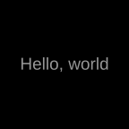</td></tr>
<tr><td><strong>Python</strong><pre><code>print("progress:17/1034|label:Build;color:cyan", flush=True)</code></pre></td><td>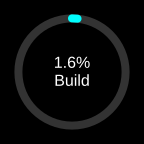</td></tr>
<tr><td><strong>Node.js</strong><pre><code>process.stdout.write('text:128|font:mono;font-size:40;color:orange\n');</code></pre></td><td>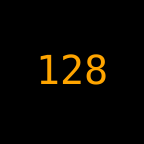</td></tr>
</tbody>
</table>

## Protocol

Send flushed UTF-8 records, one per line (`LF` or `CRLF`). Maximum payload: **262,144 bytes**, excluding the line ending. Text, cards, and progress use a **144 × 144 logical canvas**, not hardware pixels.

### Command syntax

```text
text:42|color:cyan;label:Items
```

Start options with `|`; separate `key:value` pairs with `;`. Omitted options reset to defaults on every record.

| Record | Result |
|---|---|
| `text:First\nSecond` | Two hard lines. |
| `text:Literal \\n` | Literal backslash followed by `n`. |
| `text:Ready\|label:A\nB` | Caption keeps `\n` literal. |
| `card:UP\|header:API;footer:HTTP 200` | Header and footer around a single-line main value; see [Card](#card). |

<details>
<summary>Wire format and parsing rules</summary>

| Rule | Contract |
|---|---|
| Framing | Records may span reads; blank records are ignored. |
| Plain stdout | Literal text, including JSON-looking text. |
| Options | First unescaped `\|` starts options; first `:` separates each key and value. Keys/enums are case-sensitive; whitespace is not trimmed. Quotes, commas, and later colons are literal. |
| Escapes | Use a backslash to escape `;`, `\|`, or another backslash. Unknown escapes remain literal; a dangling escape invalidates the command. |
| Hard breaks | Only explicit `text:` main content decodes `\n`, after command parsing. Plain stdout, captions, card fields, and progress keep it literal. Physical `LF`/`CRLF` always end records. |
| Numbers | Finite decimals only: no whitespace, exponent notation, or hex. |
| Defaults | Output styles are not saved preferences. `header`, `footer`, `label`, and `display` apply only to the current record; omission clears them or restores their documented defaults. |

```text
text:A\|B\;C\\D
```

Prints `A|B;C\D`.

</details>

### Shared styling

<details>
<summary>Shared options and colors</summary>

| Shared option | Default / values |
|---|---|
| `color` | Key theme (default `#969696`); text/card ink or progress fill. Opaque named color or `#RRGGBB`. |
| `background` | `#000000`; generated text, card, and progress. Built-in status artwork uses black. |
| `font` | `sans`; `sans` or `mono`. |
| `weight` | `normal`; `normal` or `bold`. |
| `label-weight` | Text/progress; defaults to headline/value `weight`; `normal` or `bold`. |
| `label-gap` | Text `8`, progress `2`; any finite nonnegative value, used only when both are visible. |
| `border` | `0`; `0`–`16` logical units. |
| `border-color` | Key theme, independently of `color`; opaque named color or `#RRGGBB`. |

Colors: 148 opaque named colors (aliases included) or six-digit `#RRGGBB`, case-insensitive and normalized to lowercase. No alpha, short hex, `transparent`, `currentColor`, CSS functions, or arbitrary CSS.

</details>

### Text

Auto-sized, wrapping text. Add `label` for a caption (centered by default); its color inherits by default.

| Record | Preview |
|---|---|
| `Hello, world` |  |
| `text:42\|font-size:48;label:Items;weight:bold;color:cyan;background:#101820;border:2;border-color:cyan` | 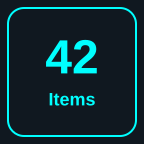 |
| `text:Build complete\|font-size:auto;overflow:wrap;color:lime` | 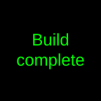 |
| `text:Big ideas\n\nsmall steps\|font-size:16;overflow:wrap;color:cyan` | 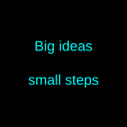 |
| `text:This is a deliberately long label\|font-size:24;overflow:ellipsis;color:violet` | 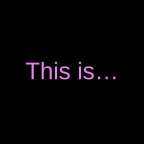 |
| `text:128\|font:mono;font-size:40;color:orange` |  |
| `text:ON\|font-size:36;label:Connected;label-size:14;label-color:white;align:left;valign:bottom;color:lime;border:2` | 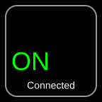 |
| `text:42\|font-size:56;label:Items;label-size:12;padding-x:10;padding-y:22;align:left;label-align:right;weight:bold;label-weight:normal;label-gap:12;color:cyan` | 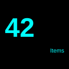 |

| Record | Result |
|---|---|
| `text:144\|label:FPS;label-position:above` | Caption above the headline. |
| `text:\|label:Ready` | Caption only; auto size 18. |
| `text:\|background:#101820` | Clear text to the selected background. |
| `text:One\nTwo\|font-size:18;padding:34;padding-y:28;line-height:2.5;border:16` | Two hard lines with wide spacing and a 16-unit frame. |

<details>
<summary>Text options and layout rules</summary>

| Text option | Default / values |
|---|---|
| `font-size` | `auto`; `auto` or any finite positive size. Auto searches from `48` down to `16`; fixed sizes, including fractional sizes, never shrink. |
| `label` | Empty; literal caption (omission clears it). |
| `label-size` | `auto`; half the fitted main font, bounded to `14`–`18` (18 for a caption alone); or any finite positive fixed size. |
| `label-color` | Effective main ink; opaque named color or `#RRGGBB`. |
| `label-position` | `below`; `above` or `below` the headline. |
| `valign` | `center`; `top`, `center`, `bottom` (whole visible block). |
| `align` | `center`; `left`, `center`, `right` (main text only). |
| `label-align` | `center`; `left`, `center`, `right` (caption only, against padded edges, including caption-only output). |
| `overflow` | `wrap`; `wrap` or one-line `ellipsis`. |
| `padding` | `16`; any finite nonnegative value sets both axes. A border may increase effective padding. |
| `padding-x`, `padding-y` | `16`; any finite nonnegative value. Each axis overrides `padding` regardless of option order; an omitted axis uses `padding`. |
| `line-height` | `1.2`; any finite value at least `1`. |

#### Wrapping

| Mode | Behavior |
|---|---|
| No visible caption | Wrap within available height. Soft wrapping respects hard lines; leading, trailing, and consecutive empty lines consume font height and spacing. |
| Auto size | Fewest complete visual lines respecting hard breaks, then largest size from 48 to 16. At 16, overflow ellipsizes the last visible line, including when only blank lines are hidden. |
| `overflow:ellipsis` | One line; decoded hard breaks become spaces. |

#### Caption layout

| Case | Behavior |
|---|---|
| Nonblank caption | Single-line headline; decoded breaks become spaces. Caption uses `label-align` (center by default) above/below; both may ellipsize. |
| Auto headline | Fit headline and caption together; largest complete headline, or ellipsize at 16 if none fits. |
| Blank headline | Caption only, centered by default; auto size 18 regardless of `label-position`. |
| Fixed headline and caption too tall together | Drop only caption and gap; keep headline size and alignment. |
| Empty/normalized blank caption | Restore ordinary wrapping. |

Whitespace and NFC normalization apply within each hard line. Main text: at most 512 graphemes, including breaks. Padding is clipped safely inside the canvas and may be increased for a border; impossible content areas or layouts skip the record. Blank main text without a visible caption clears the background. Text color options reject `accent`; `value-color` is unsupported.

</details>

### Card

Cards display a main value with optional single-line header and footer.

| Record | Preview |
|---|---|
| `card:UP\|header:API;footer:HTTP 200` | 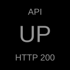 |
| `card:64°C\|header:GPU;footer:Fan 1200 rpm;font:mono;font-size:36;color:cyan;header-color:white;footer-color:lime;header-size:16;footer-size:12` | 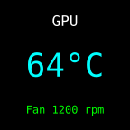 |
| `card:142/144\|header:Tests;footer:2 failed;font-size:24;header-align:left;footer-align:right;header-weight:bold;footer-color:orange;background:#101820;border:2;border-color:orange` | 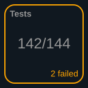 |
| `card:Build finished\|header:Status;footer:All checks OK;font-size:28;overflow:wrap;header-gap:2;footer-gap:12` | 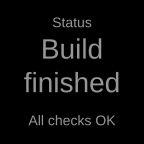 |

<details>
<summary>Card options and layout rules</summary>

| Card option | Default / values |
|---|---|
| `header`, `footer` | Empty; literal single-line record content. Empty sides reserve no space. |
| `font-size` | `auto` (default; 48 down to 16, falling back to 16) or any finite positive size; fixed sizes never shrink. |
| `align` | `center`; `left`, `center`, `right` for the main value. |
| `overflow` | `ellipsis` (default; one-line main value); `wrap` soft-wraps the main value only. |
| `header-size`, `footer-size` | `auto` (default): half the fitted main size, clamped to 14–18 (18 without main content); or any finite positive size. |
| `header-color`, `footer-color` | Main `color`; opaque named color or `#RRGGBB`. |
| `header-font`, `footer-font` | Main `font`; `sans` or `mono`. |
| `header-weight`, `footer-weight` | Main `weight`; `normal` or `bold`. |
| `header-align`, `footer-align` | `center`; `left`, `center`, `right`, independently per side. |
| `header-gap`, `footer-gap` | `8` each; any finite nonnegative value; no gap is reserved for a blank side. |
| `padding`, `padding-x`, `padding-y` | 16 per axis; any finite nonnegative value. Each axis overrides `padding`; a border may increase effective padding. |

Cards also accept `color`, `background`, `font`, `weight`, `border`, and `border-color` from [Shared styling](#shared-styling).

- Header and footer sit at the padded top and bottom edges; the main block centers vertically between their slots. `header-gap` and `footer-gap` independently set each visible side's gap.
- `overflow:wrap` soft-wraps only the main value, with fixed 1.2 line spacing; header and footer remain single-line. Auto size prefers the fewest complete lines, then the largest size from 48 down to 16. If text still overflows, the last available line ellipsizes when possible; if no line fits in the middle area, one clipped line remains.
- Ellipsized lines clip to the padded area if even the ellipsis cannot fit. Oversized lines may overlap or clip rather than being dropped; fixed main and side sizes never shrink.
- A nonpositive content area or unrepresentable geometry skips the record. An empty main value, header, and footer leave only the background and any border. `\n` stays literal in all card fields.

</details>

### Progress

```text
progress:42.5
progress:17/1034
progress:17/1034|display:17 done
```

Send a percentage or ratio. `display` changes the annotation, not the fill. Default percentages round to tenths (`17/1034` shows `1.6%`).

#### Ring

| Record | Preview |
|---|---|
| `progress:17/1034\|label:Build;color:cyan` |  |
| `progress:25\|color:orange;thickness:4;value-position:none` | 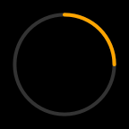 |
| `progress:75/100\|scale:100;color:violet;border:2;border-color:violet;display:3/4;value-size:20;label:Sync;label-position:above` | 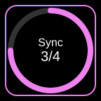 |
| `progress:75\|scale:48;thickness:2;value-size:14;label:Sync;label-size:10;label-position:above;label-weight:bold;label-gap:6;color:violet` | 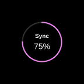 |

#### Bar

| Record | Preview |
|---|---|
| `progress:670/1000\|type:bar;display:670 MB;label:Download;color:lime;value-size:20;label-size:16;value-color:white;label-color:accent` | 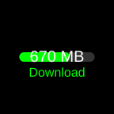 |
| `progress:35\|type:bar;color:orange;thickness:20;rounded:false;value-position:above` | 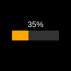 |
| `progress:90\|type:bar;color:cyan;track-color:#263746;label:Upload;label-position:above;value-position:below` | 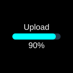 |
| `progress:65\|type:bar;scale:110;thickness:28;label:CPU;label-size:34;label-position:above;label-weight:bold;label-gap:12;color:lime` | 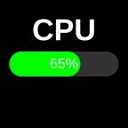 |

<details>
<summary>Progress options and layout rules</summary>

| Progress option | Default / values |
|---|---|
| `type` | `ring`; `ring` or `bar`. |
| `scale` | Ring `80`; bar `85`; any finite positive percentage. Geometry scale, not value; the track must fit the canvas and border. |
| `thickness` | Ring `8`; bar `12`; any finite positive size. The track must remain drawable and fit. |
| `track-color` | `#333333`; opaque named color or `#RRGGBB`. |
| `label` | Empty; literal text (omission clears it). |
| `display` | Rounded percent; literal text, empty hides the value (omission restores percent). |
| `value-size` | `16`; any finite positive size. |
| `value-color` | White; opaque color or lowercase `accent` (effective fill). |
| `value-position` | `center`; `center`, `above`, `below`, `none` (hides the value). |
| `label-size` | `16`; any finite positive size. |
| `label-color` | White; opaque color or lowercase `accent` (effective fill). |
| `label-position` | `below`; `above` or `below`. |
| `rounded` | `true`; `true` or `false` (ring caps/bar corners). |

#### Layout

| Rule | Contract |
|---|---|
| Input | Finite decimal percentage, or ratio with exactly one slash, two finite decimal operands, and positive denominator. Invalid input skips the record. No separate `value`/`max` options. |
| Fill | Clamp to `0`–`100`, retaining full precision (`17/1034` ≈ 1.6441%). Rings fill clockwise from 12 o'clock. |
| Default annotation | Round to nearest tenth; omit trailing `.0`. Rounding never changes fill or stops the program. |
| Custom annotation | `display` is literal text, not a template. Empty `display` or `value-position:none` hides the value. |
| Annotation colors | Lowercase `accent` follows effective fill, including theme-only redraws without explicit fill. Explicit opaque colors stay fixed. |
| Fit | Explicit display/labels may ellipsize; default percentages never truncate. Font sizes and geometry never shrink. The whole track and every visible annotation must fit the 144-unit canvas and any protected border; infeasible or undrawable layouts skip the entire record. |
| Caption gap | `label-gap` is exact for a centered ring pair or a same-side value/caption pair; otherwise it is a minimum subject to geometry. |
| Centered ring value + label | Value and caption are centered together. |

</details>

### Images

Send one-line SVG or a base64 image URI. PNG, JPEG, SVG, and WebP are supported; GIF is not.

| Record | Preview |
|---|---|
| **SVG** · `<svg …>…</svg>`<br>[Full record](assets/protocol-image-svg.txt) |  |
| **WebP** · `data:image/webp;base64,…`<br>[Full record](assets/protocol-image-webp.txt) |  |
| **PNG** · `data:image/png;base64,…`<br>[Full record](assets/protocol-image-png.txt) |  |
| **JPEG** · `data:image/jpeg;base64,…`<br>[Full record](assets/protocol-image-jpeg.txt) |  |

<details>
<summary>Image formats and validation</summary>

Base64 prefixes: `data:image/png;base64,`, `data:image/jpeg;base64,`, `data:image/svg+xml;base64,`, `data:image/webp;base64,`.

Basic MIME/base64 checks only, not full decoding or parsing. Images ignore generated colors, borders, and backgrounds and have no producer-supplied title. A custom native title may overlay them.

</details>

### Error handling

| Invalid input | Result |
|---|---|
| Invalid reserved command; duplicate, unknown, or inapplicable option; impossible layout | Skip the record; keep the previous frame; do not reinterpret as text. |
| Invalid UTF-8, oversized payload, unterminated nonblank record at EOF, or malformed recognized image prefix | Stop the program; the key shows Error with the fixed `Image protocol error.` status. |

Fix malformed output, then retry: **Stream**—tap; **Loop**—hold one second to disable, then tap. Restarting the plugin also clears a protocol error. Retry is blocked if the previous program cannot be confirmed stopped or a settings save remains unconfirmed.

<details>
<summary>Error recovery rules</summary>

| Case | Behavior |
|---|---|
| Stream protocol error | No auto-relaunch. |
| Loop nonzero exit or signal failure | Retry after the interval; fatal protocol errors require manual recovery. |
| Executable, arguments, or working-directory edit | Can clear recoverable errors after safe cleanup and confirmed save; never starts the program. |
| Setup press, theme edit, or press-mode edit | Does not clear errors. |

Error messages never include output records.

</details>

### Environment variables

Use the key's theme in your output:

```python
import os

theme = os.environ.get("ELGATO_ACTION_THEME_COLOR", "#969696")
print(f"text:Building|color:{theme}", flush=True)
```

Theme changes affect the next launch only. See [Launch Environment](docs/launch-environment.md) for all available variables.

## License

Licensed under the [Apache License 2.0](LICENSE). Bundled third-party components retain their own licenses and notices.
