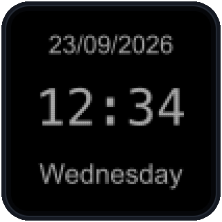
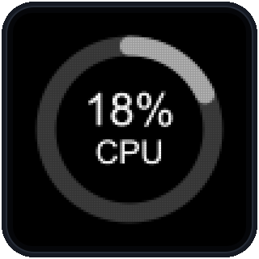
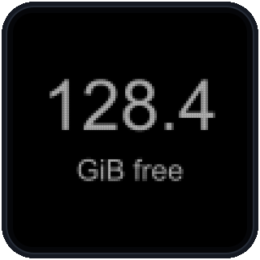

# Demos

Python demos require Python 3; `gif.py` launches with Python 3.6+ and uv (uv downloads Python/Pillow as needed). `video.sh` requires compatible FFmpeg.

## Visual demos

The direct-script examples use macOS paths and shebangs.

### [showcase.py](showcase.py) — macOS / Windows


```text
# Stream — ~28-second synthetic text/progress/image showcase; no --loop
Executable: /absolute/path/to/repo/demos/showcase.py
Arguments:
```

On Windows, select Python and pass the script path:

```text
Executable: C:\Path\To\python.exe
Arguments:  'C:\Path\To\repo\demos\showcase.py'
```

### [fluxcapacitor.py](fluxcapacitor.py) — macOS / Windows


```text
# Stream — loops by default; --once plays one three-second cycle
Executable: /absolute/path/to/repo/demos/fluxcapacitor.py
Arguments:
```

On Windows, use the Python configuration above with `fluxcapacitor.py` as the script.

### [gif.py](gif.py) — macOS / Windows


Pass a local GIF path to play your own file; omit it to use the bundled `sample.gif`. Playback loops by default; add `--once` to play it once.

```text
# macOS · Stream
Executable: /absolute/path/to/repo/demos/gif.py
Arguments:  '/absolute/path/to/my animation.gif'
```

```text
# Windows · Stream
Executable: C:\Path\To\python.exe
Arguments:  'C:\Path\To\repo\demos\gif.py' 'C:\My GIFs\animation.gif'
```

uv downloads and caches Pillow on first use. If the key shows `uv missing`, add `--uv '/absolute/path/to/uv'` (Windows: the path to `uv.exe`).

### [video.sh](video.sh) — macOS


Pass a local video path to play your own file; omit it to use the bundled `sample.mp4`. Playback runs once at 10 fps by default; add `--loop` to repeat.

```text
# macOS · Stream
Executable: /absolute/path/to/repo/demos/video.sh
Arguments:  '/absolute/path/to/my video.mp4' --ffmpeg '/absolute/path/to/ffmpeg'
```

## Clocks



### [clock.sh](clock.sh) — macOS

Cyan local time, updated every second. Uses POSIX `sh`, `date`, and `sleep`.

```text
# Stream — tap the key to start or stop
Executable: /absolute/path/to/repo/demos/clock.sh
Arguments:
```

### [clock.ps1](clock.ps1) — Windows

Cyan local time, updated every second. Uses Windows PowerShell 5.1 on Windows 11 x64.

```text
# Stream — tap the key to start or stop
Executable: C:\Windows\System32\WindowsPowerShell\v1.0\powershell.exe
Arguments:  -NoLogo -NoProfile -NonInteractive -File 'C:\absolute\path\to\repo\demos\clock.ps1'
```

The host's execution policy governs `-File`; do not weaken OS policy if the script is blocked.

## CPU



Whole-machine CPU usage, shown as a progress ring about once per second. Use **Stream**; the first reading follows a measurement interval. No extra dependencies.

### [cpu.sh](cpu.sh) — macOS 13+

```text
Executable: /absolute/path/to/repo/demos/cpu.sh
Arguments:
```

### [cpu.ps1](cpu.ps1) — Windows 11 x64

```text
Executable: C:\Windows\System32\WindowsPowerShell\v1.0\powershell.exe
Arguments:  -NoLogo -NoProfile -NonInteractive -File 'C:\absolute\path\to\repo\demos\cpu.ps1'
```

Requires Windows PowerShell 5.1. If CPU metrics are unavailable, either demo stops rather than displaying a false reading.

## Disk free space



Available space in GiB. Use **Loop** and choose a refresh **Interval**; each execution takes one reading. Other key types show `Use a Loop key`.

### [disk.sh](disk.sh) — macOS 13+

```text
Executable: /absolute/path/to/repo/demos/disk.sh
Arguments:  '/Volumes/My Drive'
```

The optional directory defaults to `/`; quote paths containing spaces. Reports space available to ordinary users on that filesystem. APFS volumes can share capacity; do not sum their readings.

### [disk.ps1](disk.ps1) — Windows 11 x64

```text
Executable: C:\Windows\System32\WindowsPowerShell\v1.0\powershell.exe
Arguments:  -NoLogo -NoProfile -NonInteractive -File 'C:\absolute\path\to\repo\demos\disk.ps1' 'C:'
```

Requires Windows PowerShell 5.1. The optional local drive (`C` or `C:`) defaults to the system drive. Measures a logical drive, not an entire physical disk.

Invalid targets or unavailable metrics fail rather than displaying a false zero.

## Counters


Increment once per execution, starting at 1. State is temporary; cleanup resets the count. `--state-key KEY` selects a shared named counter. Python and Bash keep separate state. Output delivery is not exactly-once; do not use these demos for durable accounting.

### [counter.py](counter.py) — macOS / Windows

```text
# Run — manual increments; Loop — automatic increments
Executable: /absolute/path/to/repo/demos/counter.py
Arguments:
```

On Windows, requires Python **3.13 or newer**; select the Python executable and quote the script path:

```text
Executable: C:\Path\To\python.exe
Arguments:  'C:\Path\To\repo\demos\counter.py'
```

### [counter.sh](counter.sh) — macOS

```text
# Run or Loop — Bash implementation; separate counter state
Executable: /absolute/path/to/repo/demos/counter.sh
Arguments:
```
